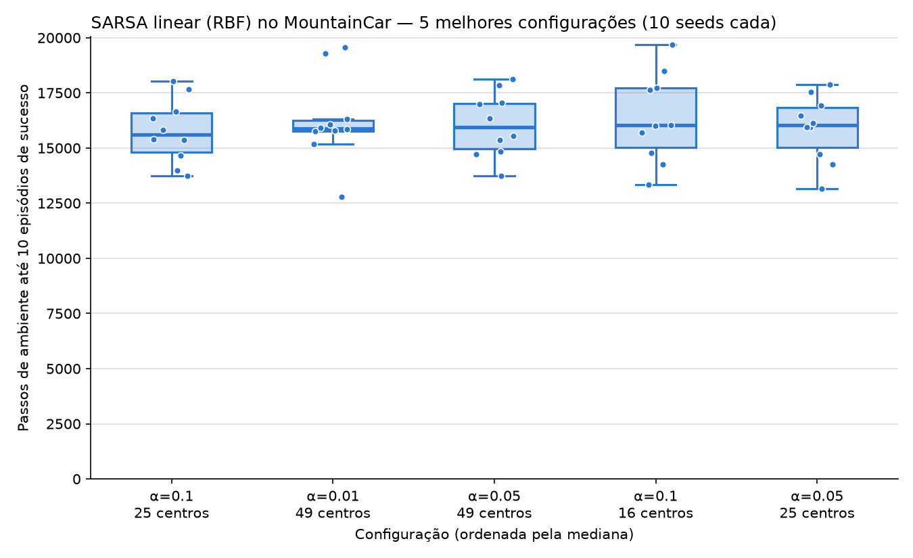

# Relatório — Comparação de hiperparâmetros (SARSA linear + RBF no MountainCar)

## Configuração do experimento

- **Grade:** taxa de aprendizado α ∈ {0.005, 0.01, 0.02, 0.05, 0.1} × número de centros RBF ∈ {9, 16, 25, 36, 49} (25 configurações).
- **Parâmetros fixos:** σ = 0.2, γ = 1.0, ε inicial = 1.0, decaimento de ε = 0.99 por episódio, ε mínimo = 0.01.
- **Execuções:** 10 seeds (0–9) por configuração, 50.000 passos de ambiente cada.
- **Métrica:** número de passos de ambiente até o agente completar 10 episódios chegando ao objetivo. Execuções que não chegam a 10 sucessos contam como 50.000.
- **Reprodução:** `python run.py` (salva `results/results.csv`) e depois `python plot.py` (gera `plots/boxplot_top5.png`).

## Resultados

As 5 configurações escolhidas são as de **menor mediana** de passos até o sucesso:

| α | Centros | Mediana | Média | Desvio | Falhas |
|---:|---:|---:|---:|---:|---:|
| 0.1 | 25 | 15606 | 15764 | 1371 | 0 |
| 0.01 | 49 | 15884 | 16250 | 1851 | 0 |
| 0.05 | 49 | 15934 | 16058 | 1368 | 0 |
| 0.1 | 16 | 16024 | 16371 | 1892 | 0 |
| 0.05 | 25 | 16042 | 15899 | 1401 | 0 |
| … | | | | | |
| 0.005 | 9 | 43682 | 43865 | 3360 | 1 |
| 0.005 | 16 | 43890 | 43908 | 924 | 0 |
| 0.1 | 9 | 50000 | 41016 | 11928 | 6 |

243 das 250 execuções atingiram 10 sucessos. A tabela completa é impressa por `plot.py`.

## Discussão

**As 5 melhores são praticamente equivalentes.** As medianas ficam entre 15,6k e 16,0k passos, e as caixas se sobrepõem quase inteiramente. A diferença entre elas é menor que a variação entre seeds (desvio ≈ 1,4–1,9k), então com 10 seeds não dá para dizer que uma é melhor que a outra. Elas são interessantes justamente por formarem um "platô": nessa região, o limite parece ser o cronograma de exploração, e não α ou o número de centros. Com decaimento de 0.99, ε só cai para ≈ 0.5 depois de ~70 episódios (~14k passos), e é por volta disso que todas começam a chegar ao objetivo com frequência.

**O que importa é a combinação de α com o número de centros.** Como as RBFs se sobrepõem, o tamanho efetivo do passo de atualização é aproximadamente α·‖φ(s)‖². Esse valor cresce com o número de centros (média medida: 0.5 com 9 centros, 1.9 com 25 e 4.2 com 49). As 5 melhores configurações têm passo efetivo entre ≈ 0.04 e 0.2, apesar de α variar 10×: a melhor configuração com α = 0.01 usa 49 centros, enquanto as melhores com α = 0.1 usam 16 ou 25.

- **Passo efetivo pequeno demais → aprendizado lento:** α = 0.005 com 16 ou 25 centros, e α = 0.01 com 16 centros, precisam de 24k a 44k passos.
- **Passo efetivo grande demais → piora:** com α = 0.1, passar de 25 para 49 centros aumenta a mediana de 15,6k para 18,1k.

**9 centros é pouco.** Com uma grade 3×3, o espaçamento entre centros (0.5) é bem maior que σ = 0.2. A representação fica grosseira demais para a função de valor do MountainCar, e 9 centros é a pior linha da grade para qualquer α. Com α = 0.1, 6 das 10 execuções nem chegam a 10 sucessos, provavelmente porque passos grandes sobre uma aproximação tão pobre fazem os pesos oscilar.

**Observação sobre ε:** com o decaimento original de 0.999 por episódio, 50k passos correspondem a só ~250 episódios, e ε terminaria em ≈ 0.78. Em testes preliminares, nenhuma configuração chegou ao objetivo, por isso o decaimento foi fixado em 0.99. Um próximo passo natural seria variar o cronograma de ε, já que ele parece ser o gargalo das melhores configurações.
